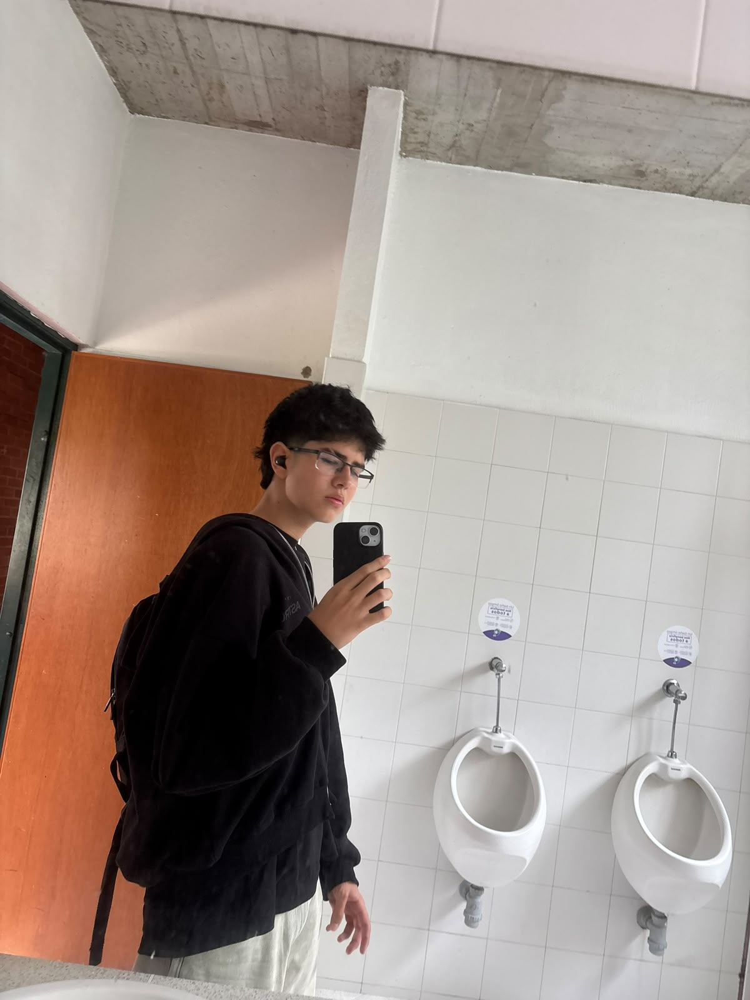

# 👨‍💻 ¡Hola! Soy Diego Parias

  

🎓 Estudiante de Ingeniería de Sistemas, interesado en el mundo de la tecnología y la creación de soluciones digitales.

## 🌟 Un poco sobre mí

Me considero una persona curiosa, creativa y motivada por descubrir cómo funcionan las cosas. Me gusta explorar nuevas ideas, experimentar con herramientas tecnológicas y convertir los conocimientos que adquiero en proyectos prácticos.

- 🌐 Me llama la atención el desarrollo web y la creación de plataformas digitales.
- ⚙️ Me interesa automatizar tareas y encontrar formas más eficientes de resolver problemas.
- 🤖 Quiero explorar las posibilidades de la inteligencia artificial y las nuevas tecnologías.
- 🧩 Disfruto analizar desafíos y buscar diferentes maneras de solucionarlos.
- 🚀 Busco mejorar constantemente mis habilidades y aprender de cada proyecto.

## 💻 Mi entorno tecnológico

Estas son algunas de las áreas y herramientas que forman parte de mi camino como desarrollador:

- **Programación:** Python, Java y fundamentos de algoritmos.
- **Entornos de desarrollo:** Visual Studio Code y Android Studio.
- **Gestión de proyectos:** Git y GitHub.
- **Desarrollo de software:** Diseño, implementación y pruebas de aplicaciones.
- **Áreas de interés:** Desarrollo web, inteligencia artificial y soluciones digitales.

## 📈 Mi camino como desarrollador

Actualmente, mi enfoque está en construir una buena base de conocimientos, practicar mediante proyectos personales y comprender las diferentes etapas del desarrollo de software.

Quiero participar en proyectos que me permitan poner a prueba mis ideas, trabajar en equipo y adquirir experiencia para afrontar desafíos tecnológicos reales.

## 🎯 ¿Qué quiero lograr?

- Crear aplicaciones funcionales y fáciles de utilizar.
- Mejorar mi lógica de programación y capacidad de análisis.
- Aprender tecnologías que tengan aplicaciones en el mundo real.
- Construir un portafolio de proyectos que refleje mi evolución profesional.

---

💡 *Cada proyecto es una oportunidad para aprender algo nuevo y llevar una idea un paso más allá.*
